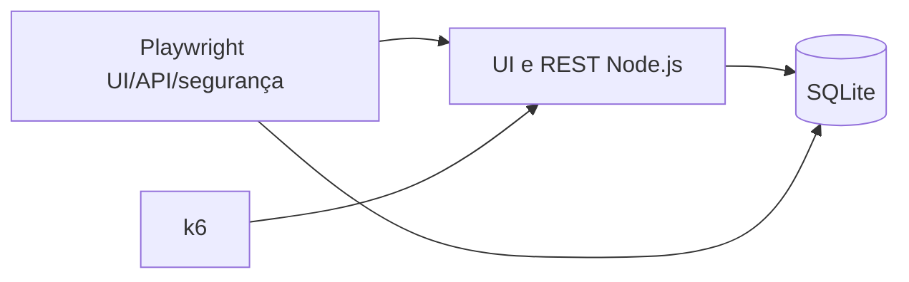

# E-commerce E2E — case de Quality Engineering

[](https://github.com/fmchiava/sdet-portfolio/actions/workflows/e2e-pipeline.yml)

Este case mostra a avaliação de qualidade de uma jornada de compra com **Web UI, API REST, SQLite, segurança e k6**. A loja Node.js usa dados sintéticos e roda localmente; o foco do trabalho é definir regras testáveis, encontrar falhas, provar correções e sustentar um parecer com evidência verificável.

## Por onde começar

1. [Descoberta e refinamento](docs/discovery/README.md): problema, levantamento, brainstorm, backlog e [decisões justificadas](docs/discovery/decisions/README.md).
2. [Contexto, processo e requisitos](docs/qa/contexto-e-requisitos.md): o que “pedido aprovado” significa neste alvo.
3. [Dossiê de QA](docs/qa/README.md): roteiro completo de estratégia, riscos, [BDD](docs/qa/bdd/README.md), [TDD](docs/qa/tdd.md), pré-requisitos e rastreabilidade.
4. [QA-001: IDOR controlado](docs/qa/defects/QA-001-idor.md): falha, causa, correção e reteste com [saídas sanitizadas](docs/qa/evidence/README.md).
5. [Execução observada](docs/qa/evidence/execution.md) e [parecer Go/No-Go](docs/qa/release-decision.md).
6. [CI no `master`](https://github.com/fmchiava/sdet-portfolio/actions/runs/40561541646) e [artefato HTML/JSON](https://github.com/fmchiava/sdet-portfolio/actions/runs/40561541646/artifacts/12760268314).

## Cobertura executável

| Camada | O que é verificado | Fonte |
| --- | --- | --- |
| UI | Login → catálogo → carrinho → checkout em Chromium, Firefox e WebKit; confirmação comparada à API e ao SQL | [`e2e-purchase.spec.ts`](src/tests/e2e-purchase.spec.ts) |
| API e contrato | HTTP 200/201/400, Zod, pedido válido/inválido e preço recalculado | [`api-contracts.spec.ts`](src/tests/api-contracts.spec.ts) |
| Segurança | Bearer ausente sem escrita, IDOR entre Alfa/Beta, fragmento SQL em login/busca | [`auth-security.spec.ts`](security/auth-security.spec.ts) |
| Performance | Rampa até 50 VUs, p95 < 500 ms, falhas HTTP < 1%, checks > 99% | [`order-load-test.js`](performance/scenarios/order-load-test.js) |
| Pipeline | Instalação, typecheck, Playwright, k6 e upload de evidências | [Workflow da raiz](../../.github/workflows/e2e-pipeline.yml) |

A suíte Playwright tem **oito cenários lógicos e dez execuções**: quatro API, três segurança e uma jornada UI em três navegadores. Os `.feature` documentam BDD, mas não são executados por um runner Cucumber. A [matriz](docs/qa/traceability.md) identifica cobertura parcial e riscos residuais; a existência de uma especificação não é contada como teste passado.

## Reproduzir

Pré-requisitos: **Node.js 24+**, npm, browsers Playwright e **k6** para o teste de carga. Consulte o [guia completo](docs/qa/pre-requisitos.md) para Windows/Linux, portas, dados sintéticos e diagnóstico. Dentro desta pasta:

```text
npm ci
npx playwright install chromium firefox webkit
npm run docs:check
npm run typecheck
npm test
npm run test:performance
```

`npm test` sobe o mock na porta 4173 e produz `playwright-report/`. `npm run test:performance` usa outra instância e banco na porta 4174 e produz `performance/results/summary.html` e `.json`. `npm run report` abre o HTML local. A CI publica os mesmos tipos de relatório por 30 dias. Nenhuma conta de comércio ou API externa é chamada.

## Arquitetura e limites



O servidor calcula preços em centavos e verifica o titular antes de devolver um pedido. O [desenho detalhado](docs/qa/arquitetura.md) mostra fluxo e fronteiras. “APROVADO” quer dizer pedido aceito pelo **mock**, sem pagamento ou entrega. O k6 mede este serviço e runner; seus números não predizem a capacidade de uma plataforma real.

## Estado da documentação

Os números do [relatório](docs/qa/evidence/execution.md) pertencem às execuções identificadas por commit e data. A [revisão documental](docs/qa/revisao-documental.md) registra a checagem desta versão. A interação QA–DEV do QA-001 é uma simulação declarada; a falha vermelha, o reteste verde e as métricas indicadas são observações preservadas.
