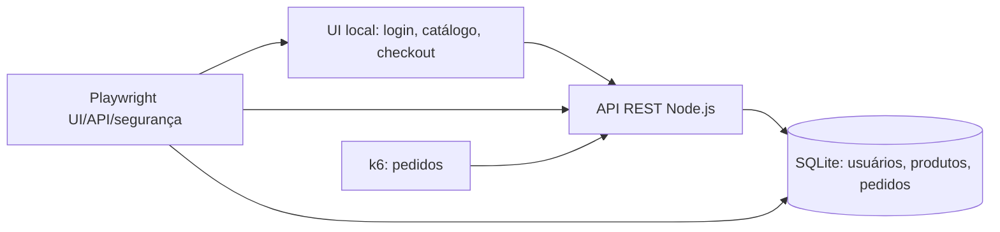
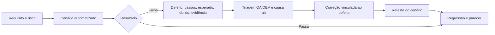

# E-commerce E2E — dossiê de Quality Engineering

[](https://github.com/fmchiava/sdet-portfolio/actions/workflows/e2e-pipeline.yml)

Este case demonstra como QA planeja, executa e comunica a qualidade de um fluxo de compra. Uma loja local de dados sintéticos oferece um alvo reproduzível; o foco são **testes Web UI, contratos REST, persistência SQL, segurança, performance e evidências auditáveis**.

## Avaliação em cinco minutos

1. [Plano de QA, riscos e critérios de aceite](docs/qa/test-strategy.md).
2. [Matriz de rastreabilidade](docs/qa/traceability.md): requisito → risco → teste → evidência.
3. [Relatório da execução local](docs/qa/evidence/execution.md) e [execuções da CI](https://github.com/fmchiava/sdet-portfolio/actions/workflows/e2e-pipeline.yml). Abra o artefato `e2e-ecommerce-evidence` de uma execução para ver Playwright HTML, traces de falhas e k6 HTML/JSON.
4. [Defeito QA-001: IDOR, correção e reteste](docs/qa/defects/QA-001-idor.md) e [procedimento QA–DEV](docs/qa/defect-lifecycle.md).
5. [Parecer técnico e Go/No-Go](docs/qa/release-decision.md).

## Arquitetura sob teste



O servidor de apoio usa Node.js sem framework HTTP e banco SQLite em arquivo. Os preços são calculados no servidor em centavos; os testes consultam a API e o banco após a compra. O teste de carga usa outro arquivo SQLite e porta própria. Não há chamada a comércio ou serviço externo.

## Cobertura executável

| Camada | Verificação | Arquivo |
| --- | --- | --- |
| Web UI | Login → catálogo → carrinho → checkout em Chromium, Firefox e WebKit | [`src/tests/e2e-purchase.spec.ts`](src/tests/e2e-purchase.spec.ts) |
| API/contrato | HTTP 200/201/400, pedido e schema Zod | [`src/tests/api-contracts.spec.ts`](src/tests/api-contracts.spec.ts) |
| Banco | Pedido `APROVADO`, titular e total de 12.990 centavos via SQL | [`src/db/database.ts`](src/db/database.ts) |
| Segurança | Bearer ausente, IDOR entre usuários e entradas de SQL Injection | [`security/auth-security.spec.ts`](security/auth-security.spec.ts) |
| Performance | Rampa até 50 VUs, p95 < 500 ms e falhas HTTP < 1% | [`performance/scenarios/order-load-test.js`](performance/scenarios/order-load-test.js) |

## Reproduzir localmente

Pré-requisitos: Node.js 24+, npm e [k6](https://grafana.com/docs/k6/latest/set-up/install-k6/) para performance. Execute na pasta deste case:

```bash
npm ci
npx playwright install chromium firefox webkit
npm run typecheck
npm test
npm run test:performance
```

`npm test` sobe e encerra automaticamente o servidor Playwright. `npm run test:performance` sobe outra instância local, executa a carga e salva `performance/results/summary.html` e `.json`. Para inspecionar o relatório Playwright localmente, use `npm run report`. Um smoke de k6 pode ser executado com `PROFILE=smoke` no ambiente.

O `.env.example` documenta `BASE_URL`, `API_URL`, `DB_PATH`, `TEST_USER` e `TEST_PASS`; o arquivo `.env` é opcional e ignorado pelo Git. As duas contas do mock são `qa.alfa@example.test` e `qa.beta@example.test`, ambas com senha **sintética** `SenhaDeTeste123!`. Os testes não precisam de credenciais reais.

## Fluxo QA → DEV → reteste



O [QA-001](docs/qa/defects/QA-001-idor.md) usa **injeção controlada de falha** para provar que a suíte detecta um IDOR: o teste observou `200` quando o esperado era `404`; após restaurar a verificação de titularidade, passou. A interação QA–DEV do estudo de caso é simulada e identificada como tal. Os resultados de execução citados nos relatórios foram observados, não inventados.

## Limites do case

O servidor e os dados são sintéticos. O resultado de k6 caracteriza apenas esta máquina ou runner, com SQLite local e carga gerada no mesmo ambiente; não dimensiona um e-commerce real. O artefato da CI tem retenção de 30 dias; este dossiê mantém o resumo verificável e os comandos de reprodução no Git.
