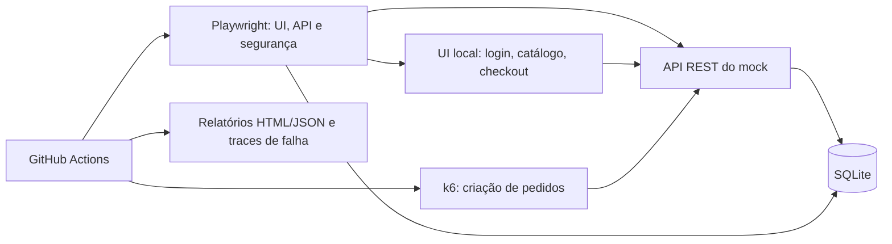
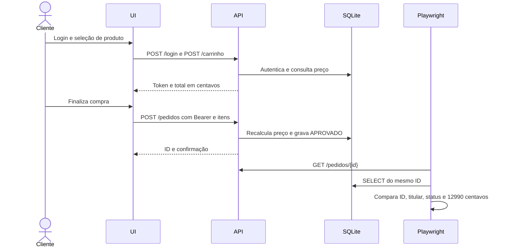

# Arquitetura sob teste e fronteiras

## Componentes

O servidor Node.js em [`src/utils/mock-server.ts`](../../src/utils/mock-server.ts) entrega três páginas HTML e as rotas REST no mesmo processo. [`src/db/database.ts`](../../src/db/database.ts) inicializa usuários e produtos, consulta registros e grava pedidos. Playwright se conecta por HTTP e abre outra conexão SQLite para verificar a gravação, sem confiar apenas na confirmação da interface. Os Page Objects escondem a navegação, mas deixam os asserts nos testes.

## Fluxo de compra e oráculos

O teste não assume um ID fixo nem uma ordem entre execuções: guarda o ID devolvido pelo servidor. O Playwright isola o armazenamento de cada contexto de navegador, enquanto pedidos persistem no arquivo SQLite da execução. Os testes de API e segurança são projetos sem navegador; o fluxo UI roda uma vez em cada um dos três navegadores.

## Ambientes e dados

| Execução | Porta | Banco | Objetivo |
| --- | --- | --- | --- |
| `npm test` | 4173 por padrão | `.data/ecommerce.sqlite` | UI, API, segurança e persistência |
| `npm run test:performance` | 4174 | `.data/performance.sqlite` | Carga em instância separada |
| CI | Mesmas portas no runner | Arquivos temporários do job | Repetição do gate e coleta de artefatos |

O Playwright inicia o servidor e aguarda `GET /health`; em execução local pode reutilizar um serviço já ativo na mesma URL. Por isso, confira a porta quando investigar um resultado inesperado. O runner de k6 sempre inicia sua própria instância na porta 4174. Os arquivos `.data/`, relatórios gerados e traces não são versionados.

## Fronteiras de confiança

O navegador controla campos, itens, quantidade, ID da URL e cabeçalho Bearer. O servidor verifica a sessão antes da escrita, valida os itens com Zod, busca preços no catálogo e compara o titular ao consultar um pedido. O SQLite não é tratado como prova suficiente de autorização: o teste IDOR precisa confirmar a resposta HTTP do outro usuário. O [escopo de segurança](security-scope.md) detalha o que foi exercitado e o que ficou fora.
