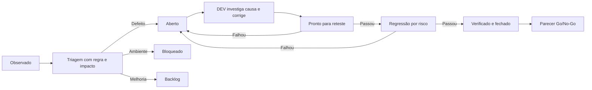

# Gestão de observações, defeitos e melhorias

## Classificar antes de corrigir

Uma **observação** é um fato reproduzível ainda sem diagnóstico. Vira **defeito** quando viola uma regra ou critério aceito; vira **melhoria** quando propõe comportamento novo. Um **bloqueio de ambiente** impede a execução (por exemplo, browser ausente) e não demonstra falha do produto. Um **problema do teste** é um assert ou massa incorreta. **Incidente** pressupõe impacto em operação real; este case sintético não tem incidentes de produção.

Severidade mede efeito no usuário ou no dado; prioridade mede a ordem de tratamento. Para este projeto: **S1 crítica** significa exposição ampla ou perda de dados; **S2 alta**, acesso indevido ou total incorreto; **S3 média**, falha funcional contornável; **S4 baixa**, apresentação. Prioridade **P0** exige interrupção imediata do gate, **P1** correção antes de Go, **P2** próxima iteração e **P3** backlog. O QA-001 é uma simulação S2/P1.

## Fluxo QA → DEV → QA

1. **Detectar e preservar:** anotar requisito, risco, commit, ambiente, comando, dados sintéticos, frequência, esperado e obtido. Guardar screenshot/trace/log sem segredos.
2. **Triar:** QA e DEV reproduzem com passos mínimos. Conferem se o oráculo é correto e se o problema é código, massa ou ambiente. Definem severidade, prioridade e critério de correção.
3. **Investigar:** DEV identifica a fronteira e a causa raiz; QA pede evidência de que a correção não mascara um efeito lateral. A solução proposta deve ser revisável.
4. **Retestar:** QA executa primeiro o cenário que falhou, em seguida testes de contrato/segurança e o E2E em três navegadores quando a alteração os afeta. Performance é repetida se o caminho de pedido ou consulta for alterado.
5. **Decidir:** só fechar com resultado observado e referência à versão corrigida. Falha no reteste reabre o defeito. O [parecer](release-decision.md) registra riscos residuais e gate.

## Registro mínimo de um ticket

`ID · tipo · estado · severidade/prioridade · regra/risco · versão · ambiente · pré-condições · passos · esperado · observado · frequência · evidências · causa raiz · solução · versão corrigida · reteste · regressão · decisão`. O [QA-001 preenchido](defects/QA-001-idor.md) é o modelo concreto.

**Papéis neste portfólio:** QA e DEV são papéis de uma simulação técnica executada pela mesma pessoa. Não há alegação de uma equipe externa, aprovação de negócio real ou incidente em produção. A saída dos comandos e os commits indicados como observados são verificáveis.
