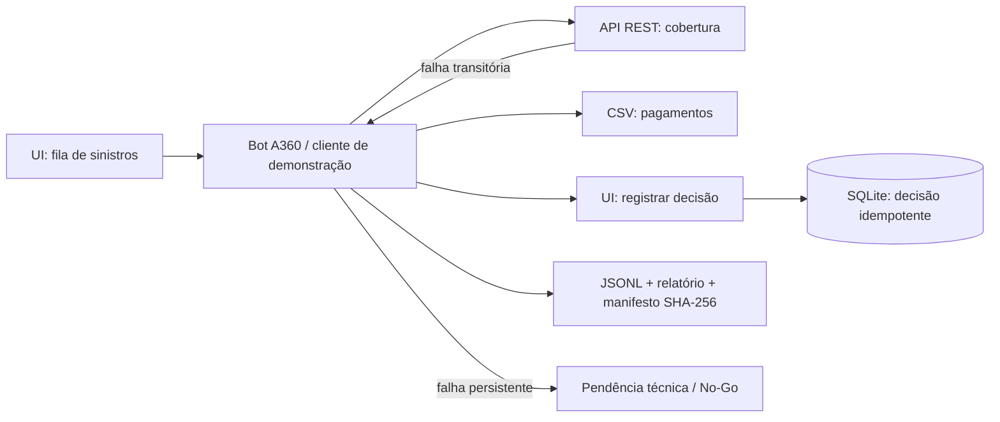

# QA de RPA — Conciliação de Sinistros de Pequeno Valor

[](https://github.com/fmchiava/sdet-portfolio/actions/workflows/python-tests.yml)

Case de portfólio **fictício e reproduzível** para demonstrar estratégia de testes, arquitetura de automação, resiliência e governança de um processo securitário. Todos os identificadores e valores são sintéticos.

> **Escopo honesto:** `app.py` fornece uma interface web, API REST e persistência local; `qa_demo.py` é um cliente Python que exercita o fluxo e produz evidências. O roteiro em `docs/arquitetura-a360.md` mostra como construir o bot na plataforma Automation Anywhere A360. Este repositório não contém um bot A360 exportado nem comprova execução em um Control Room real.

## O problema e a decisão

Uma operação recebe sinistros de pequeno valor. Antes de concluir a conciliação, a automação precisa ler a fila na **UI**, consultar uma **API REST** de cobertura, confrontar o valor com um **CSV de pagamentos** e registrar o resultado em uma aplicação apoiada por **SQLite**. Exceções de negócio seguem para revisão humana; indisponibilidade técnica deixa o item pendente.



**Regra de segurança operacional:** erro HTTP 503, timeout ou falha de UI não pode virar recusa de negócio. Falha antes da escrita mantém o item `PENDING`; se a confirmação de uma escrita possível falhar, o relatório marca `UNVERIFIED` e exige reconciliação do estado persistido antes de reprocessar.

## Executar localmente

Requisito: **Python 3.11+**. O demonstrador usa apenas a biblioteca padrão; não instala pacotes nem requer contas externas.

No primeiro terminal, a partir desta pasta:

```powershell
python app.py --db runs/demo.db --fault first
```

Acesse `http://127.0.0.1:8765/claims`. O modo `first` força um HTTP 503 na primeira consulta de cobertura e permite verificar o retry. Em outro terminal:

```powershell
python qa_demo.py --out runs/execucao-transitoria
python analyze_logs.py runs/execucao-transitoria
python -m unittest discover -s tests -v
```

O resultado esperado da execução completa é **1 conciliado, 2 encaminhados à revisão humana, 0 erros técnicos**. O comando grava `events.jsonl`, `summary.json`, `report.md` e `manifest.json` em `runs/execucao-transitoria/`. A suíte automatizada cobre 18 testes de integração e validação de dados; a [CI do monorepo](https://github.com/fmchiava/sdet-portfolio/actions/workflows/python-tests.yml) verifica Python 3.11 e 3.12 e a integridade dos exemplos.
Para repetir o resultado inicial, use um arquivo `--db` novo: o demonstrador preserva decisões anteriores de propósito.

Para reproduzir indisponibilidade persistente, interrompa o servidor, use outro banco e execute:

```powershell
python app.py --db runs/crise.db --fault always
```

No segundo terminal:

```powershell
python qa_demo.py --claim-id SIN-001 --max-attempts 2 --out runs/crise
```

O cliente encerra com código 2, emite **NO_GO** e mantém `SIN-001` pendente. Use `--fault none` para o fluxo sem falhas. Também há `--fault ui_changed` e `--fault malformed_api` para exercitar mudança de UI e contrato inválido. `--fault verify_first` e `--fault verify_always` simulam a perda transitória ou persistente da leitura após a gravação; no último caso, o relatório marca `UNVERIFIED`, mesmo quando o banco contém a decisão. Os artefatos em `examples/` mostram execuções sintéticas de referência.

## Documentação do case

| Documento | Uso |
|---|---|
| [Processo e regras](docs/processo.md) | Contexto, contratos, estados e regras de decisão |
| [Arquitetura A360](docs/arquitetura-a360.md) | Decomposição do bot, erros, credenciais, rollback e promoção |
| [Matriz de riscos](docs/matriz-riscos.md) | Controles e testes ligados a cada risco |
| [Estratégia e casos de teste](docs/estrategia-testes.md) | Cobertura funcional, exceções, dados e resiliência |
| [Gate Go/No-Go](docs/go-no-go.md) | Checklist de produção e parecer técnico |
| [Evidências e auditoria](docs/evidencias.md) | Esquema JSONL, hashes, screenshots e cadeia de custódia |
| [Simulador de crise](docs/incidente.md) | Investigação, causa raiz, correção e re-liberação |
| [Runbook operacional](docs/runbook.md) | Monitoramento, contenção, reprocessamento e reversão |
| [Roteiro para entrevista](docs/entrevista.md) | Narrativa honesta e perguntas técnicas |

## Estrutura

```text
app.py                  UI, API REST, SQLite e injeção de falhas
qa_demo.py              cliente de teste e gerador de evidências
analyze_logs.py          verifica hashes e resume eventos JSONL
tools/generate_examples.py regenera evidências sintéticas com bancos isolados
fixtures/               sinistros e pagamentos sintéticos
tests/                  testes de integração executáveis
docs/                   artefatos de QA e governança
examples/               evidências geradas em execuções de demonstração
templates/              modelos de defeito e parecer técnico
../../.github/workflows/ validação automática no GitHub
```

## Limites e extensões possíveis

O banco e a API são locais; latência, autenticação corporativa, redes e segredos reais não são simulados. A UI de demonstração é simples e o cliente Python lê seus atributos HTML, sem dirigir um navegador. Para uma prova em A360, implemente as ações de navegador, REST e Credential Vault do roteiro, execute os mesmos casos em ambiente isolado e substitua evidências sintéticas por evidências da execução autorizada.

Referências técnicas da plataforma: [Error handler](https://docs.automationanywhere.com/r/automation-360/cloud-error-handling-command), [Control Room](https://docs.automationanywhere.com/r/automation-360/cloud-manage), [Bot Lifecycle Management](https://docs.automationanywhere.com/r/automation-360/cloud-bot-lifecycle-management).
